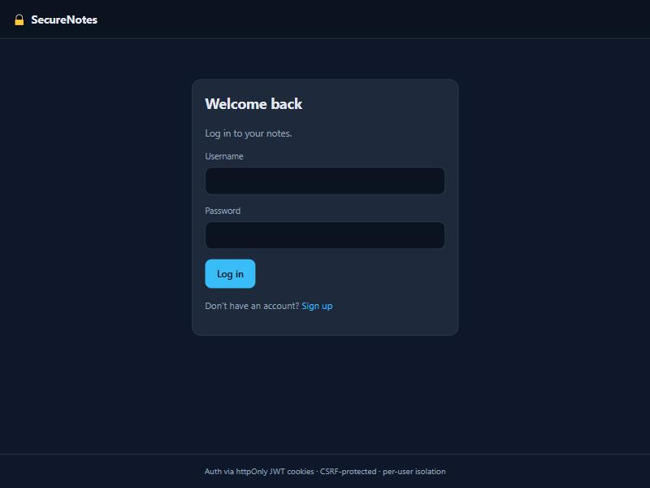
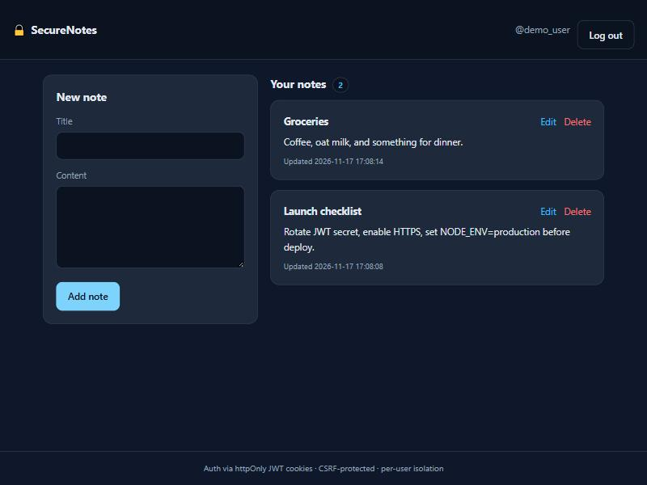

<div align="center">

# 🔒 SecureNotes

### A security-first, full-stack authenticated notes app

[](https://github.com/Loay-Hakimi/securenotes/actions/workflows/ci.yml)
[](https://react.dev)
[](https://nodejs.org)
[](https://sqlite.org)
[](LICENSE)

> Register, log in, and manage your own private notes — built to practice secure
> web-app fundamentals: **argon2** password hashing, **JWT in httpOnly cookies**,
> **CSRF protection**, **per-user data isolation**, input validation, and login
> rate limiting. Every security claim is mapped to code in [SECURITY.md](SECURITY.md).

</div>

---

## 📸 Screenshots

| Sign in / Sign up | Your notes |
|---|---|
|  |  |

## ✨ Features

- 🔐 **Real authentication** — register, log in, log out; sessions as signed JWTs
  in `httpOnly` + `SameSite=Strict` + `Secure` cookies (not in `localStorage`).
- 📝 **Notes CRUD** — create, read, update, delete, scoped strictly to the
  logged-in user.
- 🛡️ **Per-user isolation** — one user can never see or touch another's notes
  (a foreign note returns `404`, verified by tests).
- 🧰 **Security controls** — argon2id hashing, CSRF double-submit tokens, zod
  input validation, parameterized SQL, `helmet` headers, login rate limiting.
- 🐳 **Dockerized** — `docker compose` runs the stack **behind the SecureCore
  gateway**.

## 🔒 Security

Full OWASP Top 10 (2021) mapping — what's implemented, where in the code, and
what's intentionally out of scope — is in **[SECURITY.md](SECURITY.md)**. A few
highlights:

| Control | How |
|---------|-----|
| Password storage | **argon2id** (memory-hard) — never plaintext |
| Sessions | signed JWT in `httpOnly`+`SameSite=Strict`+`Secure` cookie |
| CSRF | double-submit token on all state-changing requests |
| SQL injection | 100% parameterized prepared statements |
| Access control | every query scoped by `user_id`; foreign notes → `404` |
| Brute force | per-IP rate limiting on login/register |
| Secrets | from env only; app refuses to boot in prod without a strong `JWT_SECRET` |

## 🏗️ Architecture

```
          ┌─────────────┐      ┌──────────────────────┐      ┌──────────────┐
client ──▶│  SecureCore │ ──▶  │  web (nginx)         │ ──▶  │  backend     │
 :8080    │  gateway    │      │  SPA + /api proxy    │      │  Express API │
          │  (rate/DDoS │      └──────────────────────┘      │  + SQLite    │
          │   + headers)│                                    └──────────────┘
          └─────────────┘
```

- **frontend/** — Vite + React SPA (auth + notes UI), talks to `/api` same-origin.
- **backend/** — Express API, better-sqlite3, argon2, JWT, CSRF, zod, helmet.
- **deploy/** + **docker-compose.yml** — runs everything behind SecureCore.

## 🚀 Quick Start (local dev)

Run the API and the SPA in two terminals. The Vite dev server proxies `/api` to
the backend, so cookies work same-origin with no CORS.

```bash
# 1) Backend  (http://localhost:4000)
cd backend
cp .env.example .env     # dev works with defaults; set JWT_SECRET for prod
npm install
npm run dev
```

```bash
# 2) Frontend (http://localhost:5173)
cd frontend
npm install
npm run dev
```

Open **http://localhost:5173**, create an account, and start taking notes.

## 🧪 Tests

The backend has a Vitest + Supertest suite covering the auth flow, CSRF,
validation, rate limiting, and **per-user authorization isolation**.

```bash
cd backend
npm test
```

## 🐳 Run the full stack behind SecureCore (Docker)

The gateway builds from the sibling [`securecore`](https://github.com/Loay-Hakimi/securecore)
repo, so check out **both repositories side by side**.

```bash
# from the securenotes/ directory
cp .env.example .env
node -e "console.log(require('crypto').randomBytes(48).toString('hex'))"  # paste into JWT_SECRET
docker compose up --build
```

Then open **http://localhost:8080** — all traffic now flows through SecureCore
(rate limiting, DDoS guard, security-header injection) to the app.

## 📁 Structure

```
securenotes/
├── backend/            # Express API
│   ├── src/            # config, db, auth, csrf, validation, routes, app, server
│   └── test/           # vitest + supertest (auth, notes, authz isolation)
├── frontend/           # Vite + React SPA
│   └── src/            # App, AuthForm, NotesApp, api client
├── deploy/             # SecureCore gateway config for compose
├── docker-compose.yml  # client → gateway → web (nginx) → backend
├── SECURITY.md         # OWASP Top 10 → code mapping
└── docs/screenshots/
```

## 📄 License

MIT — see [LICENSE](LICENSE).
